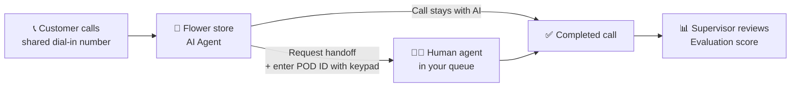

# 📊 AI Quality Management

!!! abstract "What is AI QM?"
    The **Evaluations** feature lets supervisors create customized **Evaluation Forms** to assess human agent and AI Agent interactions automatically. AI analyzes each interaction and generates a score against the criteria defined by the supervisor.

-   🤖 **Automatic scoring**

    ---

    Every interaction is analyzed by AI against your pre-defined criteria.

-   ✍️ **Manual adjustment**

    ---

    Supervisors can adjust scores. Adjustments are used to improve the AI models.

-   📈 **Individual and aggregated**

    ---

    Scores are available per interaction and aggregated per agent, to show performance trends.

-   ✅ **Consistent feedback**

    ---

    Objective, consistent quality assurance that helps maintain high service standards.

## 🌸 Story

!!! quote "The supervisor's rule"
    Both the **human agent** and the **AI Agent** must **always ask for the customer's name and the occasion for the flowers**. Based on these criteria they will be evaluated, and additional training will be provided.

## 🗺️ Call Flow Overview

| Step | What happens | Who |
|:---:|---|---|
| 1️⃣ | The supervisor logs in to the Supervisor Desktop, which is configured with Evaluation Forms for human agents and AI Agents. | 🧑‍💼 Supervisor |
| 2️⃣ | A new call to the shared dial-in number (**UK** `+442045208103` or **US** `+14692501220`) enters the voice flow. The caller asks the AI Agent for a **handoff** and enters their **POD / Attendee ID with the keypad (DTMF)** to be routed to their own queue. | 📞 Customer |
| 3️⃣ | The human agent talks to the customer about the flower order. | 👩‍💼 Human agent |
| 4️⃣ | After the call, the supervisor checks whether the human agent asked the questions from the Evaluation Form. | 🧑‍💼 Supervisor |
| 5️⃣ | A separate call is handled entirely by the AI Agent. | 🤖 AI Agent |
| 6️⃣ | After that call, the supervisor checks whether the AI Agent asked the required questions, using the form assigned to the AI Agent. | 🧑‍💼 Supervisor |

## 🎯 Your missions

-   🧑‍💼 **Mission 1**

    ---

    Evaluate the **human agent** with an Evaluation Form assigned to your queue.

-   🤖 **Mission 2**

    ---

    Evaluate the **AI Agent** with a form assigned to your AI Agent.

-   🏅 **Mission 3**

    ---

    Configure **Coaching Insights** and review Team Performance.

